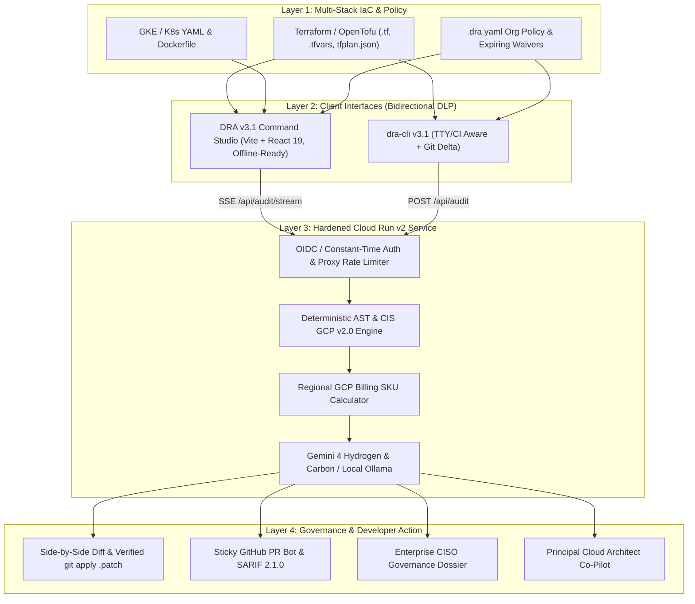

<div align="center">
  <h1 align="center">Deployment Readiness Auditor (DRA v3.1)</h1>
  <p align="center">
    <strong>Hybrid Deterministic AST + Gemini 4 Cloud Governance Studio &amp; CI/CD Gatekeeper</strong>
  </p>
  <p align="center">
    <a href="https://dra.damiansztankowski.cloud/"><strong>Live Demo</strong></a> •
    <a href="#-quickstart-under-3-minutes"><strong>Quickstart</strong></a> •
    <a href="#-supported-intelligence--gemini-4-matrix"><strong>Gemini 4 Matrix</strong></a> •
    <a href="#-command-studio-5-mode-workbench"><strong>Command Studio</strong></a> •
    <a href="#-organization-policy--waivers-drayaml"><strong>.dra.yaml Policy</strong></a>
  </p>
  <p align="center">
    
    
    
    
  </p>
</div>

<details>
<summary><strong>⚠️ Disclaimer: AI Usage, Cloud Costs, and Data Privacy (Click to expand)</strong></summary>

### 1. Hybrid Static + Generative AI Notice
DRA pairs a deterministic AST/CIS rule engine with Google Gemini 4 (or local Ollama / LM Studio models) to synthesize cross-resource attack paths and remediation code. Always validate generated changes with `terraform plan` prior to production rollout.

### 2. Cloud Billing Responsibility
Running live LLM calls against the Google Gemini API or hosting DRA on Google Cloud Run incurs standard usage charges on your own Google Cloud / AI Studio account. You can also run DRA in **100% zero-cost Offline Deterministic AST Mode** (`--llm-provider static`) or against local self-hosted models.

### 3. Privacy & Bidirectional Client-Side DLP
DRA executes **Bidirectional Client-Side DLP** in both the browser and `dra-cli`: high-entropy secrets (`AIzaSy...`, `AKIA...`, PEM private keys, tokens, passwords) are permanently scrubbed before network transmission, while project IDs, VPCs, emails, and private IPs are mapped to semantic aliases (`CLOUD_ID_1`, `NETWORK_TOPOGRAPHY_1`) in local memory and restored locally upon response.

</details>

---

## Overview

The **Deployment Readiness Auditor (DRA v3.1)** is a Google Cloud-native DevSecOps Command Studio and CI/CD quality gatekeeper. It audits **Terraform (`.tf`, `.tfvars`), OpenTofu (`.tofu`), execution plans (`tfplan.json`), Kubernetes/GKE manifests (`.yaml`), and `Dockerfile`s** before infrastructure changes reach production.

DRA evaluates workloads against all five pillars of the **Google Cloud Well-Architected Framework** (*Security & Compliance, Cost Optimization, Reliability, Operational Excellence, and Performance Efficiency*) and maps every finding to **CIS GCP Benchmark v2.0, NIST SP 800-53 Rev. 5, ISO/IEC 27001:2022, SOC 2 Type II, PCI DSS v4.0, EU GDPR Art. 32, and HIPAA**.

---

## ✨ Key Capabilities (v3.1)

- **🖥️ Command Studio UI & 5-Mode Workbench**: Collapsible desktop Command Rail, native HTML Popover mobile drawer, Same-Document SPA View Transitions, perceptual OKLCH Sapphire & Obsidian design system, and side-by-side **Split Workbench** inspection.
- **🧠 Gemini 4 Frontier Suite + Deterministic AST Engine**: Powered by **`gemini-4-hydrogen`** by default (with built-in presets for `gemini-4-carbon`, `gemini-4-neon`, `gemini-4-argon`, and `gemini-3.8-flash`), bounded by prompt-injection-immune HCL/K8s/Docker AST score ceilings—plus a zero-key **Offline Deterministic Mode** (`static`).
- **⚡ Real-Time SSE Streaming Pipeline**: Live Server-Sent Events (`/api/audit/stream`) stream progress across *DLP Redaction → Static AST → Regional FinOps SKUs → Org Policy → AI Synthesis*.
- **🩹 Side-by-Side Diff Viewer & `git apply`-Verified Patches**: Emits POSIX unified Git patches (`dra-remediation.patch`) verified against `git apply --check`, paired with an interactive Before/After visual diff modal and click-to-jump line highlighting.
- **💰 Regional GCP Cloud Billing SKU Calculator**: Deterministic monthly baseline vs. optimized spend across GCP regions (`us-central1`, `europe-west1`, `europe-west3`, `asia-northeast1`, etc.), `count` multipliers, Committed Use Discounts (CUDs), external IPv4 fees, and zombie disk detection.
- **⚖️ Organization Policy-as-Code (`.dra.yaml`) & Expiring Waivers**: Enforce mandatory FinOps labels, EU/US data-residency regions, banned legacy VM families (`n1-`, `f1-`), and time-bounded waivers attested in executive CISO reports.
- **🤖 Principal Cloud Architect Co-Pilot & Historical Drift**: Interactive remediation guidance grounded in any finding (zero-downtime Terraform state moves, PSC refactors, IAM least privilege) plus historical baseline score/blocker delta comparisons.
- **🔒 Production Security Hardening**: 100% locally bundled Vite + Tailwind SPA (zero external runtime CDNs), `net.BlockList` IPv4/IPv6 SSRF & redirect defense, `google-auth-library` OIDC audience/domain verification, `__Host-` HMAC session cookies, strict `DOMParser` Mermaid SVG sanitization, and non-root multi-stage Docker runtime.

---

## 🖥️ Command Studio 5-Mode Workbench

Inside **Audit Studio**, engineers and security reviewers can switch seamlessly across five purpose-built views without losing editor context:

| Studio View | Primary Persona | What It Displays |
| :--- | :--- | :--- |
| **1. Split Workbench** | Platform / Cloud Engineers | Side-by-side line-numbered IaC & `.dra.yaml` editor on the left + live Findings, Diffs, and Co-Pilot on the right. Clicking `main.tf # Ln 14` scrolls & highlights the exact line immediately without vertical page jumping. |
| **2. Executive Overview** | Tech Leads / SecOps | Deployment Gate Verdict (`BLOCKED` / `CONDITIONAL` / `READY`), Maturity Grade (`A+`–`F`), ScoreCard donut, 5-Pillar Radar chart, and priority blockers. |
| **3. Topology Canvas** | Cloud Architects | Full-width interactive sanitized Mermaid dependency & blast-radius graph with zoom, pan, fullscreen modal, and per-pillar status cards. |
| **4. FinOps & Compliance** | FinOps & GRC Auditors | Regional GCP Cloud Billing SKU optimization ledger + 6-Framework Regulatory Compliance Matrix + `.dra.yaml` waiver register. |
| **5. Full Report** | End-to-End Reviewers | Unified single-page layout combining all telemetry panels in sequence. |

---

## 🧠 Supported Intelligence & Gemini 4 Matrix

| Provider / Model ID | Tier | Recommended Use Case | API Key Required |
| :--- | :--- | :--- | :--- |
| `gemini-4-hydrogen` | **Default • Fast** | Fastest Gemini 4 frontier model (1M context) for agentic IaC audits & CI/CD gates | `API_KEY` |
| `gemini-4-carbon` | **Deep Frontier** | Maximum multi-hop security & regulatory compliance reasoning depth | `API_KEY` |
| `gemini-4-neon` | **Code & Arch** | Multi-module Terraform & GKE refactoring exploration | `API_KEY` |
| `gemini-4-argon` | **Sparse MoE** | Low-cost enterprise compliance synthesis on large monorepo plans | `API_KEY` |
| `gemini-3.8-flash` / `gemini-3.1-pro-preview` | **3.x Series** | Stable Gemini 3.x alternatives for version-pinned enterprise pipelines | `API_KEY` |
| `static` (`dra-deterministic-ast-v3`) | **Zero-Key AST** | Instant `<50ms` CIS GCP v2.0 + Regional FinOps + `.dra.yaml` audit ($0 cost) | **None** |
| `ollama` / `lm-studio` (`gemma4:e2b`) | **Air-Gapped** | 100% local developer workstation inference over loopback | **None** |

---

## 🏗️ System Architecture



---

## ⚡ Quickstart (Under 3 Minutes)

### 1. Run the Command Studio Web UI + Backend Server

```bash
cd dra-app
npm ci
npm run build

# Option A: Full Hybrid Mode (Deterministic AST + Google Gemini 4 Hydrogen)
API_KEY="YOUR_GEMINI_API_KEY" npm start

# Option B: Zero-Key Offline Deterministic AST Mode (100% local, $0 cost)
npm start

# Option C: Local Air-Gapped Ollama / LM Studio
LLM_PROVIDER=ollama LLM_MODEL=gemma4:e2b LLM_URL=http://localhost:11434/api/generate npm start
```

Open **`http://localhost:8080`** in your browser.

### 2. Run the Standalone Go CLI (`dra-cli` v3.1)

```bash
# Run race-detector unit tests and compile binary to ./dra-cli/bin/dra-cli
make -C dra-cli test build

# Scan a directory recursively with .dra.yaml policy gates & verified Git patch output
./dra-cli/bin/dra-cli scan \
  --path ./infra/terraform \
  --deep-scan \
  --yes \
  --policy .dra.yaml.example \
  --llm-model gemini-4-hydrogen \
  --fail-on critical,high \
  --min-score 75 \
  --fix-patch dra-remediation.patch

# PR Delta Mode: scan only Git-modified IaC files relative to production
./dra-cli/bin/dra-cli scan --path . --changed-only --base origin/production

# Emit Sticky GitHub Pull Request Markdown or SARIF 2.1.0 for GitHub Code Scanning
./dra-cli/bin/dra-cli scan --demo --output github-pr --output-file pr-summary.md
./dra-cli/bin/dra-cli scan --demo --output sarif --output-file dra-results.sarif
```

---

## ⚖️ Organization Policy & Waivers (`.dra.yaml`)

Commit a `.dra.yaml` file (see [`.dra.yaml.example`](.dra.yaml.example)) at your repository root to enforce custom platform guardrails and auditable, time-bounded risk exceptions:

```yaml
organization: "Acme Cloud Platform"
requiredLabels:
  - environment
  - owner
  - cost_center
allowedRegions:
  - us-central1
  - europe-west1
bannedMachinePrefixes:
  - n1-
  - f1-
customRules:
  - "All production Cloud SQL databases must enforce regional HA and PITR backups."
waivers:
  - id: "CIS 4.8"
    resource: "google_compute_instance.legacy_gateway"
    reason: "Kernel migration scheduled in Q1; isolated behind IAP."
    approvedBy: "ciso@acme.internal"
    expires: "2027-03-31"
```

Active waivers move matching findings into the **Accepted Risk Exceptions Register** without failing CI/CD; once the ISO `expires` date passes, expired waivers automatically revert to active gate blockers.

---

## 🔧 Environment Variables Reference

| Variable | Default | Description |
| :--- | :--- | :--- |
| `API_KEY` | — | Google Gemini API key (mounted via GCP Secret Manager in production). |
| `LLM_PROVIDER` | `gemini` | Default backend engine (`gemini`, `static`, `ollama`, `lm-studio`). |
| `LLM_MODEL` | `gemini-4-hydrogen` | Default model identifier when none is specified per request. |
| `ALLOW_STATIC_FALLBACK` | `false` | Automatically fall back to `static` AST engine if `API_KEY` is unset. |
| `DRA_API_KEY` | — | Optional shared bearer secret protecting `/api/audit` endpoints. |
| `DRA_SESSION_SECRET` | random 32B | HMAC-SHA256 secret signing `__Host-dra_session` browser cookies across Cloud Run replicas. |
| `DRA_ALLOWED_AUDIENCE` | — | Expected OIDC token audience URL verified via `google-auth-library`. |
| `DRA_ALLOWED_DOMAIN` | — | Optional Google Workspace `hd` claim restriction (e.g. `acme.com`). |

---

## ☁️ Production Deployment on Google Cloud Run

### Option A: Self-Audited Terraform Stack (`infra/terraform/`)
Provisions Cloud Run v2, Secret Manager mounts, dedicated least-privilege IAM Service Account, and optional GitHub Actions Workload Identity Federation:

```bash
cd infra/terraform
terraform init
terraform plan \
  -var="project_id=deployment-readiness-auditor" \
  -var="service_name=dra-v3" \
  -var="llm_model=gemini-4-hydrogen" \
  -var="container_image=us-central1-docker.pkg.dev/deployment-readiness-auditor/dra/dra-app:v3.1.0"
```

### Option B: Direct Source Deploy
```bash
gcloud run deploy dra-v3 \
  --source dra-app/ \
  --project deployment-readiness-auditor \
  --region us-central1 \
  --port 8080
```

Ready-to-use GitHub Actions CI & PR Gatekeeper workflows are provided in [`docs/workflows/`](docs/workflows/).

---

## 🧪 Automated Test Suites

```bash
# TypeScript strict check + Vitest unit & security suite (DLP, SSRF, AST, FinOps, Waivers, git apply, Gemini 4 presets)
npm --prefix dra-app run typecheck
npm --prefix dra-app test

# Go CLI unit & concurrency race-detector suite
make -C dra-cli test
```

---

## 📄 License & Governance

- Distributed under the **MIT License** — see [`LICENSE.md`](LICENSE.md).
- Contribution guidelines: [`CONTRIBUTING.md`](CONTRIBUTING.md) • Security policy: [`SECURITY.md`](SECURITY.md).

> [!NOTE]
> **Independent Open-Source Project**: This project is built and maintained by the community and is not an official Google or Google Cloud product.
