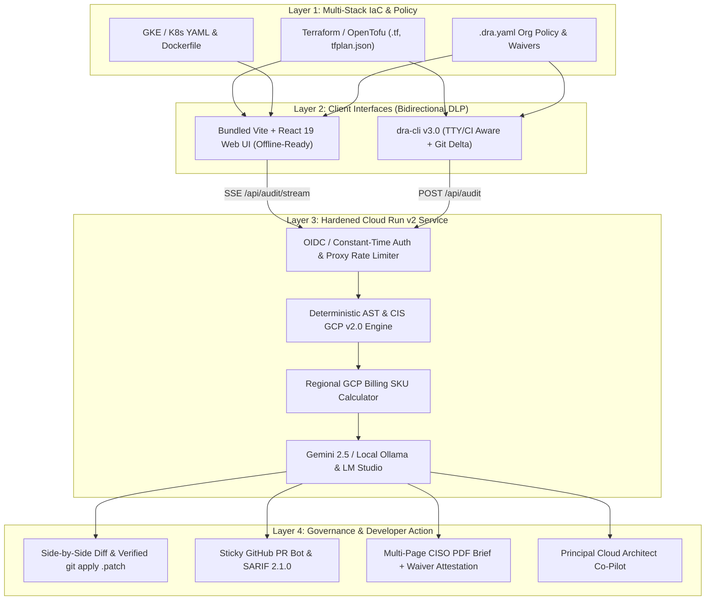

<div align="center">
  <h1 align="center">✨ Deployment Readiness Auditor (DRA v3.0) ✨</h1>
  <p>
    <strong>
      <a href="https://dra.damiansztankowski.cloud/">🔴 View Live Demo</a>
    </strong>
  </p>
  <p>
    
    
    
    
  </p>
</div>

<details>
<summary><strong>⚠️ Disclaimer: AI Usage, Cloud Costs, and Data Privacy (Click to read)</strong></summary>

### 1. Hybrid Static + Generative AI Notice
DRA combines a deterministic AST/CIS rule engine with Google Gemini (or local Ollama / LM Studio models) to synthesize cross-resource attack paths and remediation code. Always validate generated changes with `terraform plan` prior to production rollout.

### 2. Cloud Billing Responsibility
Running live LLM calls against the Google Gemini API or hosting DRA on Google Cloud Run incurs standard usage charges on your own Google Cloud / AI Studio account. You can also run DRA in **100% zero-cost Offline Deterministic AST Mode** (`--llm-provider static`) or against local self-hosted models.

### 3. Privacy & Client-Side DLP
DRA executes **Bidirectional Client-Side DLP** in both the browser and `dra-cli`: high-entropy secrets (`AIzaSy...`, PEM keys, passwords) are permanently scrubbed before network transmission, while project IDs, VPCs, emails, and private IPs are replaced with semantic aliases (`CLOUD_ID_1`, `NETWORK_TOPOGRAPHY_1`) and restored locally upon response.

</details>

---

**Architect with Confidence. Audit with Intelligence.**

The **Deployment Readiness Auditor (DRA v3.0)** is an enterprise-grade, Google Cloud-native DevSecOps platform and CI/CD quality gatekeeper. It audits **Terraform (`.tf`), OpenTofu (`.tofu`), execution plans (`tfplan.json`), Kubernetes/GKE manifests (`.yaml`), and `Dockerfile`s** before changes reach production.

DRA evaluates workloads against the **Google Cloud Well-Architected Framework** (Security, Cost Optimization, Reliability, Operational Excellence, and Performance Efficiency) and maps findings directly to **CIS GCP Benchmark v2.0, NIST SP 800-53 Rev. 5, EU GDPR Art. 32, HIPAA, PCI DSS v4.0, and SOC 2 Type II**.

---

## 🚀 What's New in v3.0

- **🧠 Hybrid Deterministic AST + AI Engine**: Pairs a fast, prompt-injection-immune HCL/K8s/Docker static analyzer (exact start/end lines, variable & `.tfvars` interpolation, CIS GCP v2.0 baseline) with Gemini 2.5 cross-resource attack-path synthesis—plus a zero-key **Offline Deterministic Mode** (`static`).
- **⚡ Real-Time SSE Streaming Pipeline**: Live Server-Sent Events (`/api/audit/stream`) stream progress across DLP Redaction → Static AST → Regional FinOps SKUs → Org Policy → AI Synthesis.
- **🩹 Side-by-Side Diff Viewer & `git apply`-Verified Patches**: Genuine POSIX unified Git patches (`dra-remediation.patch`) verified against `git apply --check`, paired with an interactive Before/After visual diff modal and click-to-jump line highlighting in the code editor.
- **💰 Regional GCP Cloud Billing SKU Calculator**: Deterministic monthly baseline vs. optimized cost modeling across GCP regions (`us-central1`, `europe-west1`, `europe-west3`, `asia-northeast1`, etc.), `count` multipliers, Committed Use Discounts, and zombie disk detection.
- **⚖️ Organization Policy-as-Code (`.dra.yaml`) & Expiring Risk Waivers**: Enforce mandatory labels, EU/US data-residency regions, banned machine families, and auditable time-bounded waivers logged directly in the CISO PDF Brief.
- **🤖 "Ask the Principal Architect" Co-Pilot & Historical Drift Comparison**: Contextual remediation chat grounded in any finding, plus side-by-side historical scan score/blocker delta tracking.
- **🔒 Enterprise Security Hardening**: Bundled Vite + Tailwind offline-ready SPA (zero external runtime CDNs), `net.BlockList` IPv4/IPv6 SSRF & redirect protection, `google-auth-library` OIDC token verification, `__Host-` session cookies, strict Mermaid SVG DOM sanitization, and multi-stage non-root Docker runtime.

---

## 🏗️ System Architecture



---

## ⚡ Quickstart (Under 3 Minutes)

### 1. Run Locally (Web UI + API Server)

```bash
cd dra-app
npm ci
npm run build

# Option A: Full Hybrid Mode (Static AST + Google Gemini 2.5)
API_KEY="YOUR_GEMINI_API_KEY" npm start

# Option B: Zero-Key Offline Deterministic AST Mode (100% local, $0 cost)
npm start

# Option C: Local Self-Hosted Ollama / LM Studio
LLM_PROVIDER=ollama LLM_MODEL=gemma4:e2b LLM_URL=http://localhost:11434/api/generate npm start
```
Open **`http://localhost:8080`** in your browser.

### 2. Run the CLI (`dra-cli` v3.0)

```bash
# Run tests and compile binary to ./dra-cli/bin/dra-cli
make -C dra-cli test build

# Scan a directory recursively with CI quality gates & verified Git patch output
./dra-cli/bin/dra-cli scan \
  --path ./infra/terraform \
  --deep-scan \
  --yes \
  --policy .dra.yaml.example \
  --fail-on critical,high \
  --min-score 75 \
  --fix-patch dra-remediation.patch

# PR Delta Mode: scan only Git-modified IaC files relative to production
./dra-cli/bin/dra-cli scan --path . --changed-only --base origin/production

# Generate GitHub Pull Request sticky comment Markdown or SARIF 2.1.0
./dra-cli/bin/dra-cli scan --demo --output github-pr --output-file pr-summary.md
./dra-cli/bin/dra-cli scan --demo --output sarif --output-file dra-results.sarif
```

---

## ☁️ Production Deployment on Google Cloud Run

### Option A: Terraform Production Module (Recommended — Secret Manager + Least-Privilege SA + WIF)
Provision DRA using its self-audited Terraform stack in [`infra/terraform/`](infra/terraform/):

```bash
cd infra/terraform
terraform init
terraform plan \
  -var="project_id=deployment-readiness-auditor" \
  -var="service_name=dra-v3" \
  -var="container_image=us-central1-docker.pkg.dev/deployment-readiness-auditor/dra/dra-app:v3.0.0"
```

### Option B: Direct Source Deploy
```bash
gcloud run deploy dra-v3 \
  --source dra-app/ \
  --project deployment-readiness-auditor \
  --region us-central1 \
  --allow-unauthenticated \
  --port 8080
```

---

## 🧪 Automated Test Suites

```bash
# Run Vitest unit & security suite (DLP, SSRF, Static AST, FinOps, Waivers, git apply check)
npm --prefix dra-app test

# Run Go CLI unit tests with race detector
make -C dra-cli test
```

---

## 📄 License

Distributed under the MIT License. See [`LICENSE.md`](LICENSE.md) for details.

> [!NOTE]
> **Independent Tool**: This project is a community contribution and is not officially endorsed or maintained by Google.
